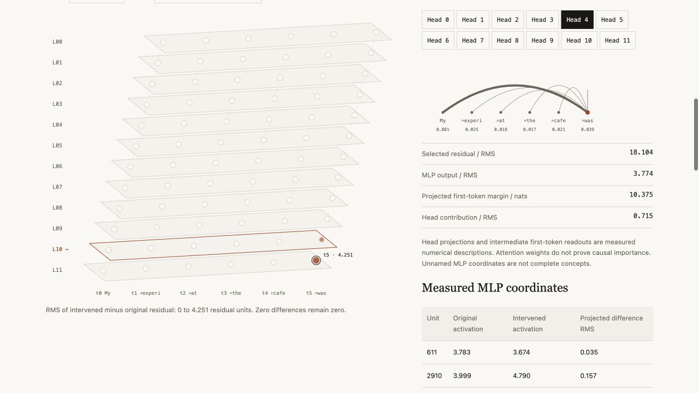

# Gradia Lens

**Change a real model component. Measure behavior and side effects. Restore it.**

Gradia Lens is an Apache-2.0 research toolkit for reversible experiments on a
pinned open model. It runs locally without a Gradia account, API key, database,
or hosted service. This alpha supports GPT-2 on deterministic CPU inference.

The same engine powers the model research workbench inside Gradia. This public
package contains the engine, versioned probes, bounded search, generated
challenges, CLI, and receipt replay. Its license applies to this package; it does
not grant a license to the surrounding Gradia application or model weights.

This is Gradia's open-source **Intervention Atlas** research project, published
as **Gradia Lens**. Source, issues and contributions live in
[gradia-lens](https://github.com/rudycelekli/gradia-lens). The first qualified
alpha is `0.1.0a1`. PyPI publication is pending. The
[Gradia product page](https://www.gradiahq.com/lens) is the intended website
entry point; the public source repository is available independently.

## Explore a real recorded experiment

```bash
git clone https://github.com/rudycelekli/gradia-lens.git
cd gradia-lens
python -m pip install .
gradia-lens view examples/records/positive-tone.json --output /tmp/gradia-lens.html
```

Open `/tmp/gradia-lens.html` in your browser. Navigate twelve transformer blocks,
select tokens and attention heads, compare original and intervened answers,
inspect measured side effects, and undo the recorded intervention. No model
checkpoint, Gradia account or network connection is needed for viewing.

This example is a reviewed synthetic recording. Live experiments below execute
the pinned model locally. Recorded controls select measured settings; they
do not simulate unmeasured effects.



This captured view displays real numerical measurements. Structural connectors
show model architecture; they do not establish a complete causal circuit.

## Install

The base package requires Python 3.9 or later. The pinned optional model extra
targets Python 3.9–3.12; NumPy 1.26.4 has no Python 3.13 wheel. Real checkpoint
tests were exercised with
Python 3.9.6, Torch 2.8.0, Transformers 4.57.3, and NumPy 1.26.4. The wheel is
pure Python. Optional inference dependencies include platform-specific binaries.

```bash
# From the directory containing a reviewed release wheel:
python -m pip install ./gradia_lens-0.1.0a1-py3-none-any.whl
gradia-lens --help
gradia-lens catalog
gradia-lens doctor

# Install the exact optional inference versions:
python -m pip install './gradia_lens-0.1.0a1-py3-none-any.whl[model]'
```

Alternatively, clone this repository or unpack the source archive and run
`python -m pip install '.[model]'` from its top directory. Release artifacts
are available through [GitHub Releases](https://github.com/rudycelekli/gradia-lens/releases).

Base installation has zero runtime dependencies. Import, help, catalog, and
doctor do not import Torch, download a checkpoint, or run inference. Doctor
checks installed distribution metadata; it is not a model execution test.

The first inference command downloads the safetensors checkpoint for
`openai-community/gpt2`, revision
`607a30d783dfa663caf39e06633721c8d4cfcd7e`. Set `GRADIA_LENS_CACHE_DIR` or pass
`--cache-dir`. The default is `$XDG_CACHE_HOME/gradia-lens/hub`, falling back to
`~/.cache/gradia-lens/hub`. `--offline` requires this exact checkpoint to be
already cached. No model weights are included in either release archive.

## Run an investigation

```bash
gradia-lens compare --experiment positive-tone --layer 10 --strength 0.35 \
  --max-new-tokens 16 --output receipts/compare.json
gradia-lens trace --experiment positive-tone --layer 8 --strength 0.15 \
  --output receipts/trace.json
gradia-lens view receipts/trace.json --output receipts/trace.html
gradia-lens head --layer 8 --head 4 --fraction 1 --output receipts/head.json
gradia-lens weight --layer 8 --neuron 1253 --gain 0 --output receipts/weight.json
gradia-lens evaluate --experiment positive-tone --strength 0.35 \
  --include-confirmation --output receipts/evaluate.json
gradia-lens search --experiment future-tense --layers 8 10 \
  --strengths 0 0.15 0.35 --budget 6 --output receipts/search.json
gradia-lens challenge --strength 0.35 --budget 12 --output receipts/challenge.json
gradia-lens replay receipts/compare.json --output receipts/replayed.json
```

Every command has `--help`. Model operations accept `--offline` and `--cache-dir`.
`view` turns recorded evidence into a self-contained interactive HTML page that
can be opened in a browser offline. It loads no checkpoint. Views display only
captured measurements; new controls require another recorded experiment.
Custom `--prompt` is supported for compare, trace, head, and weight. A custom
prompt uses the experiment's declared target candidate vocabulary unless it
matches a versioned probe exactly; its scores do not independently verify a new
semantic label. `trace` accepts at most 48 tokens; other inputs are bounded to
256 tokens, generation to 64 new tokens, and search/challenge to 24 trials.

`search` evaluates discovery data only while selecting candidates, then audits
the single selected setting on confirmation data. A user choosing another
setting after reading confirmation has converted that set into exploratory
data and should collect fresh confirmation examples.

## Python API

```python
from gradia_lens import catalog
from gradia_lens.api import execute, load_receipt, replay, save_receipt

print([item["id"] for item in catalog()])
receipt = execute(
    "compare",
    {
        "experiment_id": "positive-tone",
        "layer": 10,
        "strength": 0.35,
        "max_new_tokens": 16,
    },
)
save_receipt("receipts/compare.json", receipt)
verified = replay(load_receipt("receipts/compare.json"))
assert verified["replay"]["measurements_exact"]
```

For repeated work, explicitly create and reuse `from gradia_lens import Engine`
and pass `engine=engine` to `execute` or `replay`. That imports optional model
libraries; constructing the engine loads the pinned model. Direct `Engine`
methods expose measured raw results, while `execute` adds public receipt
integrity and a full parameter restoration check.
Use the declared intervention methods. Direct modifications of `Engine.model`
are outside this supported lifecycle, can invalidate fitted directions or
cached baselines, and are rejected by the receipt API while parameter drift is
present. Recreate the engine to discard such external changes and derived caches.

## Evidence and boundaries

The three built-in experiments study positive-tone, space-association, and
future-tense completion preferences. Candidate continuation log probabilities
are measured in nats. These are versioned hand-written lexical probes, not a
general correctness, safety, reasoning, or factual editing benchmark.

Trace captures real attention matrices, per-head projected contribution norms,
MLP contribution summaries, residual changes, and intermediate vocabulary
readouts. It also patches entire downstream last-token residuals to their
baseline values. Broad restoration here does not establish a unique causal
path. The map covers declared tensors; it is not a complete thought graph.

Head suppression and MLP row scaling are actual reversible interventions.
Weight preview restores the original parameter bytes in a `finally` block and
verifies the full parameter digest, logits, tokens, and hook cleanup. It does
not train weights or install a persistent factual edit.

Challenge proposals use mechanical wording variants from discovery examples.
Their inherited labels require review; measured losses are candidate failures,
not independently verified factual mistakes. Adaptive search is a transparent
heuristic. No general speed advantage, unlimited exploration, or novelty claim
has been demonstrated. See [RESEARCH.md](docs/RESEARCH.md) for the method and study
questions.

Receipts contain prompts, continuations, measured tensors/scores, model and
source hashes, and configuration. Keep private prompts and outputs out of
public issue reports. SHA-256 binds bytes; it is not an author signature or
proof that a third party ran the experiment. Exact replay requires the same
implementation edition and matching computation. It fails on altered receipts,
source mismatches, model mismatches, or differing measured values.

## Development

See [CONTRIBUTING.md](CONTRIBUTING.md), [SECURITY.md](SECURITY.md), and
[CHANGELOG.md](CHANGELOG.md). Core functionality is available in the open-source
package without premium authentication. Hosted collaboration or other premium
services are future product options, not shipped package requirements.

## Research and roadmap

See [the prospective research plan](docs/RESEARCH_PLAN.md) for matched-budget
intervention discovery and visual investigation studies. These are study plans,
not completed benchmark claims. Locally usable inspection, interventions and
export remain open source; future paid Gradia services may provide hosted
compute, larger campaigns and private team collaboration.
